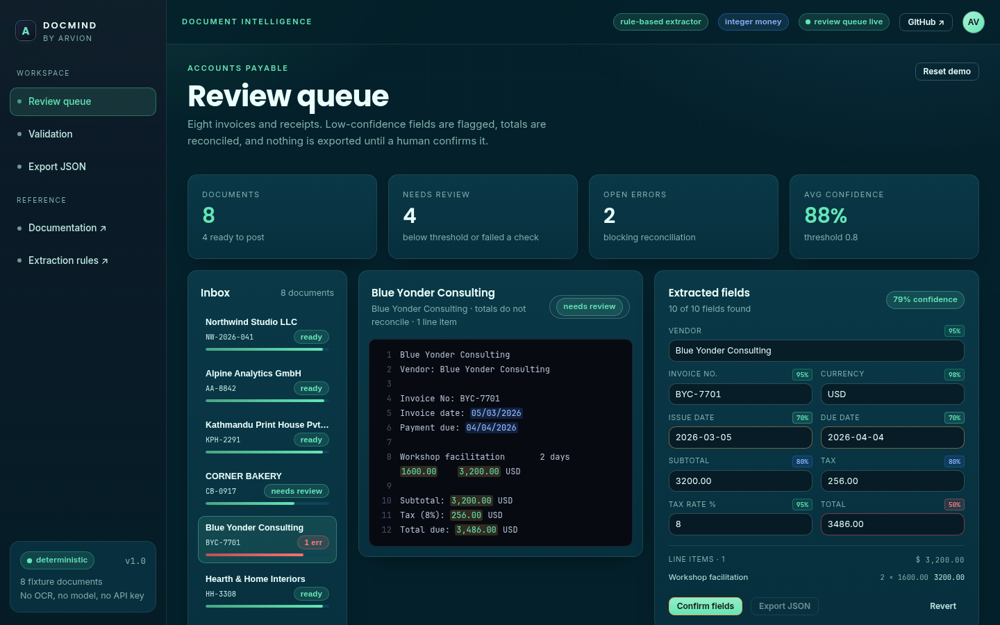
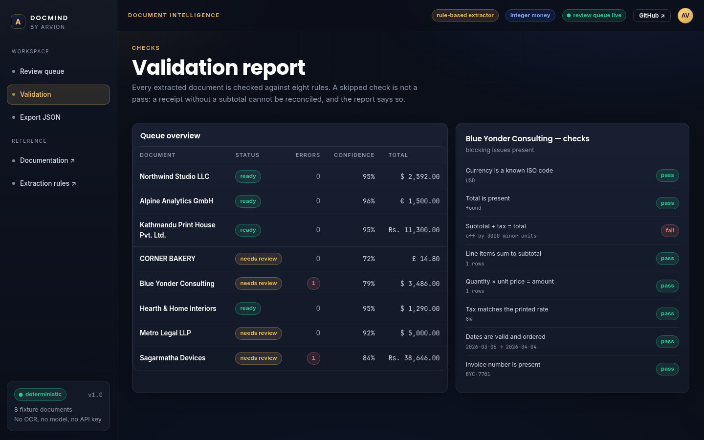

<div align="center">

</div>

<sub>Recorded from the live demo — <a href="docs/demo.mp4">MP4</a> · <a href="docs/screenshot.png">static frame</a></sub>

# DocMind

Document intelligence for invoices and receipts without an OCR bill. A rule-based
extractor pulls the vendor, invoice number, dates, line items, subtotal, tax and
total out of plain text; a confidence model decides which documents need a human
to look at them. The demo is the review screen: source text on the left,
extracted fields with confidence chips on the right, and an export that is only
enabled after someone confirms the numbers.

[**Live demo**](https://arvion-technology.github.io/labs/demos/docmind/demo/) · [MIT](LICENSE)

---

AP automation usually means a PDF parser, an OCR model and an LLM extractor,
priced per page and impossible to test offline. DocMind strips that stack down to
what can be built deterministically: labelled amounts, printed dates, whitespace
columns and integer arithmetic. On an invoice whose fields are labelled, that is
enough. On a photographed receipt it is not, and the confidence model says so
instead of pretending.

The demo ships eight fixture documents with deliberately different problems: a
clean USD invoice, a EUR reverse-charge invoice, an NPR bill with `Rs.` amounts, a
bakery receipt with VAT included, a document whose totals do not add up, a
pipe-separated table, a tax-exempt invoice and one with the due date before the
issue date.

## What it does

- **Extract** vendor, invoice number, issue date, due date, currency, subtotal,
  tax, tax rate, total and line items from invoice text.
- **Score** every field with a confidence value, then roll those into a document
  score and a review decision.
- **Validate** eight rules: totals reconcile, line items sum to the subtotal,
  per-item maths, tax rate, date order, currency, invoice number, missing fields.
- **Queue** documents as `ready` or `review`, accept corrections, re-run the
  checks after an edit, and export confirmed records as JSON.
- **Explain** each decision: the source line used for a field, the exact
  difference in a failed reconciliation, and skipped checks marked as skipped.
- **Demo** the whole flow in a static page with three screens: review queue,
  validation report and export record.

## Screenshots

| Review screen | Validation report |
| --- | --- |
|  |  |

## Architecture

```
  src/fixtures.js      8 documents + expected values (integer minor units)
          │
          ▼
  src/extract.js       labels → amounts, dates, line-item columns
          │            no model, no network; unknown stays null
          ▼
  src/validate.js      8 checks → issues[] (error | warning) + checks[]
          │
          ▼
  src/confidence.js    per-field adjustment + weighted document score
          │            threshold 0.8 decides "ready" vs "review"
          ▼
  src/queue.js         review → confirmed → exported
          │            corrections re-enter the validator
          ▼
  src/pipeline.js      processDocument(document) — one path for demo + tests
          │
          ├── demo/app.js   review UI, source highlighting, JSON export
          └── test/         45 node:test cases over fixtures and edge cases
```

Money never becomes a float. `parseAmount("$2,592.00")` returns `259200` and every
comparison works on those integers, so "off by one cent" is an exact test failure
rather than a rounding mystery.

## Quickstart

```bash
git clone https://github.com/arvion-technology/docmind.git
cd docmind
npm test          # 45 tests, no dependencies, Node 20+
npm run demo      # static server on http://localhost:4173
```

There is nothing to install: `package.json` exists so `npm test` has a standard
entry point. To use the pipeline from Node:

```js
import { FIXTURES } from "./src/fixtures.js";
import { processDocument } from "./src/pipeline.js";
import { applyCorrections, exportEntry, markExported } from "./src/queue.js";

const entry = { extraction: processDocument(FIXTURES[4]) };
console.log(entry.extraction.issues);       // total_mismatch: expected 345600, actual 348600

const fixed = applyCorrections({ ...entry, status: "review", corrections: {} }, { total: "3,456.00" });
console.log(fixed.extraction.reconciled);   // true
console.log(markExported({ ...fixed, status: "confirmed" }).status); // exported
```

## How it works

### Extraction is rules, and the rules are the test fixtures

`extract.js` finds fields by labels and layout, not by position. A total is the
last amount on a line matching `grand total`, `total due`, `amount due`,
`balance due`, or a bare `total` that is not a subtotal. A tax line is accepted
when it carries a percentage, or when the line starts with the tax label — that
second rule is what stops a receipt's `TOTAL (VAT included): £14.80` being read as
tax. Dates go through four formats (ISO, `14 March 2026`, `March 14, 2026`,
`05/03/2026`) and slash dates are marked 70% confident because day-first and
month-first cannot both be right.

Line items are the messy part. The parser handles three shapes:

```
Brand identity        1      1800.00    1800.00      ← whitespace columns
Oak shelving | 3 | 300.00 | 900.00                    ← pipe table
Flat white x2                     7.20                ← receipt line
```

Each shape is a unit-tested case, and a line-item sum that disagrees with the
subtotal lowers the `lineItems` confidence instead of silently changing the
total.

### Confidence is about review, not certainty

A field's confidence starts from how it was found (`Vendor: ...` is 0.95, a
guessed first line is 0.72) and is then reduced by the validation issues it
participates in. A broken reconciliation takes 0.45 from the total, 0.15 from the
subtotal and tax, and nothing from the vendor — the failure says nothing about
the vendor. The document score is a weighted average: total ×3, subtotal, tax,
currency and line items ×2, the rest ×1. Anything below 0.8, or any error,
routes the document to review.

On the eight fixtures that produces four `ready` and four `review` documents with
two blocking reconciliation errors, which is the mix the demo shows.

### Corrections re-run validation

`applyCorrections` does not just overwrite a value. It marks the field as
human-sourced at confidence 1, re-runs the eight checks and recomputes the
document score. In the demo, editing the broken total from `3,486.00` to
`3,456.00` clears the red badge and enables export. Editing it to something else
keeps the document blocked — the UI cannot be used to launder a wrong number.

The queue is a one-way state machine: `review → confirmed → exported`. Exported
entries are immutable, because the export is the record of what was signed off.

## Tests

```bash
npm test
```

45 tests on `node:test` across four files:

- `extract.test.js` — money parsing, currency detection, tax rounding, every
  fixture's headline fields, all four date formats, three line-item shapes,
  receipt tax handling, vendor fallback and the empty document.
- `validate.test.js` — each of the eight rules, including the exact 3,000 minor
  unit difference in the broken fixture, warnings versus errors, and skipped
  checks for receipts with no subtotal.
- `confidence.test.js` — weighting, issue penalties, review decisions and the
  labels the UI uses.
- `queue.test.js` — classification, corrections that clear errors, corrections
  that do not, confirmation, export immutability, JSON shape and coercion.

The demo has a static check as well:

```bash
node scripts/serve-check.mjs
```

## Limitations

- **No OCR and no PDF parsing.** Input is text. A PDF or photo needs a text
  extraction step first; that is a different product decision with a different
  cost model.
- **Rules are shaped by the fixture formats.** A vendor that puts the total in a
  table cell, or writes `1.234,56`, will not parse. The confidence model flags
  the result as low, which is the intended failure mode, but it is still a
  failure.
- **No LLM extractor ships.** The pipeline has one entry point
  (`processDocument`), so an LLM extractor can be added before validation and
  compared against these rules, but that adapter is not written here.
- **Line items are read-only in the UI.** Field corrections cover the nine scalar
  fields; editing an individual line item is not implemented.
- **Single-currency documents.** There is no FX conversion; the currency is
  detected and validated, not converted.

## Project layout

```text
docmind/
├── src/
│   ├── fixtures.js      # 8 documents with expected values
│   ├── money.js         # integer minor units, currency detection
│   ├── extract.js       # label and column parsers
│   ├── validate.js      # 8 reconciliation checks
│   ├── confidence.js    # per-field and document scoring
│   ├── queue.js         # review/confirm/export state machine
│   └── pipeline.js      # extract → validate → score
├── test/                # 45 node:test cases
├── demo/                # review UI, imports ../src directly
├── scripts/             # serve, screenshot, bundle checks
└── docs/                # screenshots
```

## Credits

Built by [Arvion Technologies](https://arviontech.net) in Kathmandu as part of our
open-source [Labs](https://github.com/arvion-technology/labs) series. If you are
drowning in invoices and want the review queue more than the model, this is a
reasonable place to start.

MIT licensed.
